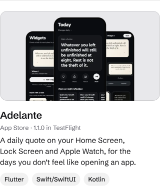
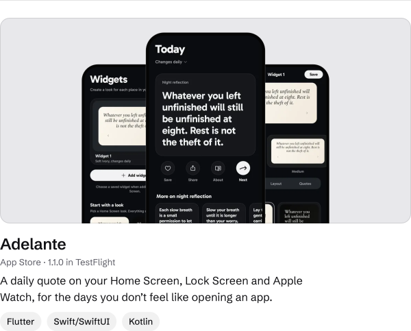
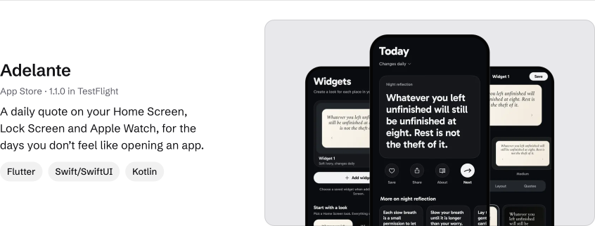
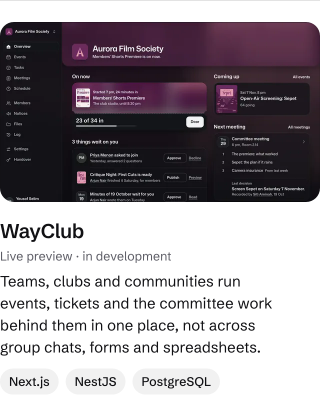
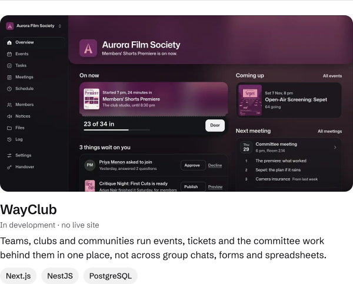
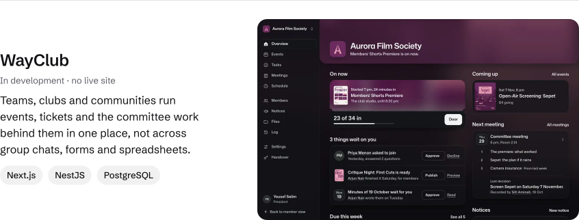
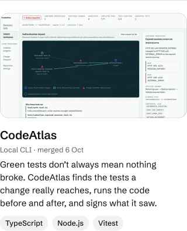
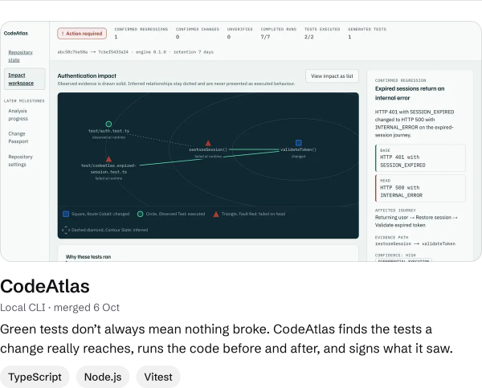
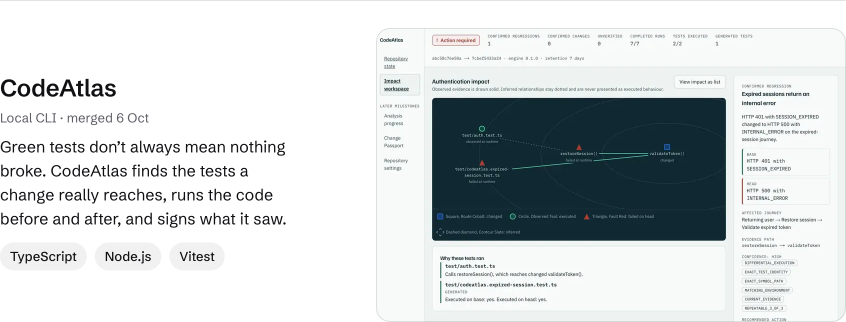

<a href="https://yousofselim.com/" aria-label="Yousof Selim, Software Engineering student. I build and ship real apps. Two are live on the App Store. Available for an internship, 25 January to 23 April 2027. Subang Jaya, Malaysia."><picture><source media="(min-width: 592px) and (max-width: 767px), (min-width: 880px)" srcset="assets/blank.svg"><source media="(prefers-color-scheme: dark)" srcset="assets/hero-dark-phone.svg"></picture><picture><source media="(max-width: 591px), (min-width: 768px) and (max-width: 879px), (min-width: 1154px)" srcset="assets/blank.svg"><source media="(prefers-color-scheme: dark)" srcset="assets/hero-dark-mid.svg"></picture><picture><source media="(max-width: 1153px)" srcset="assets/blank.svg"><source media="(prefers-color-scheme: dark)" srcset="assets/hero-dark-wide.svg"></picture></a>

<a href="https://yousofselim.com/Yousof-Selim-Resume.pdf"><picture><source media="(prefers-color-scheme: dark)" srcset="assets/btn-resume-dark.svg"></picture></a>
<a href="https://yousofselim.com/simple/"><picture><source media="(prefers-color-scheme: dark)" srcset="assets/btn-recruiters-dark.svg"></picture></a>
<a href="https://yousofselim.com/"><picture><source media="(prefers-color-scheme: dark)" srcset="assets/btn-portfolio-dark.svg"></picture></a>

<a href="https://yousofselim.com/#work" aria-label="Selected work. Five products, each built end to end by me."><picture><source media="(min-width: 592px) and (max-width: 767px), (min-width: 880px)" srcset="assets/blank.svg"><source media="(prefers-color-scheme: dark)" srcset="assets/head-work-dark-phone.svg"></picture><picture><source media="(max-width: 591px), (min-width: 768px) and (max-width: 879px), (min-width: 1154px)" srcset="assets/blank.svg"><source media="(prefers-color-scheme: dark)" srcset="assets/head-work-dark-mid.svg"></picture><picture><source media="(max-width: 1153px)" srcset="assets/blank.svg"><source media="(prefers-color-scheme: dark)" srcset="assets/head-work-dark-wide.svg"></picture></a>

<a href="https://yousofselim.com/work/bupples/" aria-label="Bupples. App Store and Google Play · 1.4.6. Split the bill, skip the awkward follow-up. Scan a receipt, tap who had what, and Bupples works out who owes whom, to the cent. Built with Flutter, Firebase and Vertex AI. The screenshot shows the profile, accent editor and settings screens."><picture><source media="(min-width: 592px) and (max-width: 767px), (min-width: 880px)" srcset="assets/blank.svg"><source media="(prefers-color-scheme: dark)" srcset="assets/work-bupples-dark-phone.svg"></picture><picture><source media="(max-width: 591px), (min-width: 768px) and (max-width: 879px), (min-width: 1154px)" srcset="assets/blank.svg"><source media="(prefers-color-scheme: dark)" srcset="assets/work-bupples-dark-mid.svg"></picture><picture><source media="(max-width: 1153px)" srcset="assets/blank.svg"><source media="(prefers-color-scheme: dark)" srcset="assets/work-bupples-dark-wide.svg"></picture></a>

<a href="https://yousofselim.com/work/bupples/"><picture><source media="(prefers-color-scheme: dark)" srcset="assets/go-case-study-dark.svg"></picture></a>
<a href="https://apps.apple.com/my/app/bupples/id6777620291"><picture><source media="(prefers-color-scheme: dark)" srcset="assets/go-app-store-dark.svg"></picture></a>
<a href="https://play.google.com/store/apps/details?id=com.bupples.bupples"><picture><source media="(prefers-color-scheme: dark)" srcset="assets/go-google-play-dark.svg"></picture></a>
<a href="https://github.com/yeegz/Bupples-showcase"><picture><source media="(prefers-color-scheme: dark)" srcset="assets/go-showcase-dark.svg"></picture></a>

<a href="https://yousofselim.com/work/adelante/" aria-label="Adelante. App Store · 1.1.0 in TestFlight. A daily quote on your Home Screen, Lock Screen and Apple Watch, for the days you don’t feel like opening an app. Built with Flutter, Swift/SwiftUI and Kotlin. The screenshot shows the widgets, Today and widget editor screens of version 1.1.0."><picture><source media="(min-width: 592px) and (max-width: 767px), (min-width: 880px)" srcset="assets/blank.svg"><source media="(prefers-color-scheme: dark)" srcset="assets/work-adelante-dark-phone.svg"></picture><picture><source media="(max-width: 591px), (min-width: 768px) and (max-width: 879px), (min-width: 1154px)" srcset="assets/blank.svg"><source media="(prefers-color-scheme: dark)" srcset="assets/work-adelante-dark-mid.svg"></picture><picture><source media="(max-width: 1153px)" srcset="assets/blank.svg"><source media="(prefers-color-scheme: dark)" srcset="assets/work-adelante-dark-wide.svg"></picture></a>

<a href="https://yousofselim.com/work/adelante/"><picture><source media="(prefers-color-scheme: dark)" srcset="assets/go-case-study-dark.svg"></picture></a>
<a href="https://apps.apple.com/us/app/adelante-daily-quotes/id6816598027"><picture><source media="(prefers-color-scheme: dark)" srcset="assets/go-app-store-dark.svg"></picture></a>
<a href="https://github.com/yeegz/adelante-showcase"><picture><source media="(prefers-color-scheme: dark)" srcset="assets/go-showcase-dark.svg"></picture></a>

<a href="https://yousofselim.com/work/wayclub/" aria-label="WayClub. In development · no live site. Teams, clubs and communities run events, tickets and the committee work behind them in one place, not across group chats, forms and spreadsheets. Built with Next.js, NestJS and PostgreSQL. The screenshot shows the committee workspace for a fictional film society, with a running event and decisions waiting."><picture><source media="(min-width: 592px) and (max-width: 767px), (min-width: 880px)" srcset="assets/blank.svg"><source media="(prefers-color-scheme: dark)" srcset="assets/work-wayclub-dark-phone.svg"></picture><picture><source media="(max-width: 591px), (min-width: 768px) and (max-width: 879px), (min-width: 1154px)" srcset="assets/blank.svg"><source media="(prefers-color-scheme: dark)" srcset="assets/work-wayclub-dark-mid.svg"></picture><picture><source media="(max-width: 1153px)" srcset="assets/blank.svg"><source media="(prefers-color-scheme: dark)" srcset="assets/work-wayclub-dark-wide.svg"></picture></a>

<a href="https://yousofselim.com/work/wayclub/"><picture><source media="(prefers-color-scheme: dark)" srcset="assets/go-case-study-dark.svg"></picture></a>
<a href="https://github.com/yeegz/WayClub-showcase"><picture><source media="(prefers-color-scheme: dark)" srcset="assets/go-showcase-dark.svg"></picture></a>

<a href="https://yousofselim.com/work/photoshoot/" aria-label="Photoshoot. Web app and Windows 1.5.1. Strike a pose, pick from 52 live effects and reactive face masks, keep the strip. Nothing from your camera leaves your device. Built with TypeScript, Electron, WebGL2 and MediaPipe. The screenshot shows the Photoshoot product site for version 1.5.1."><picture><source media="(min-width: 592px) and (max-width: 767px), (min-width: 880px)" srcset="assets/blank.svg"><source media="(prefers-color-scheme: dark)" srcset="assets/work-photoshoot-dark-phone.svg"></picture><picture><source media="(max-width: 591px), (min-width: 768px) and (max-width: 879px), (min-width: 1154px)" srcset="assets/blank.svg"><source media="(prefers-color-scheme: dark)" srcset="assets/work-photoshoot-dark-mid.svg"></picture><picture><source media="(max-width: 1153px)" srcset="assets/blank.svg"><source media="(prefers-color-scheme: dark)" srcset="assets/work-photoshoot-dark-wide.svg"></picture></a>

<a href="https://yousofselim.com/work/photoshoot/"><picture><source media="(prefers-color-scheme: dark)" srcset="assets/go-case-study-dark.svg"></picture></a>
<a href="https://photoshoot-yeegz.web.app/app/"><picture><source media="(prefers-color-scheme: dark)" srcset="assets/go-open-app-dark.svg"></picture></a>
<a href="https://github.com/yeegz/photoshoot/releases/tag/v1.5.1"><picture><source media="(prefers-color-scheme: dark)" srcset="assets/go-windows-dark.svg"></picture></a>
<a href="https://github.com/yeegz/photoshoot"><picture><source media="(prefers-color-scheme: dark)" srcset="assets/go-source-dark.svg"></picture></a>

<a href="https://yousofselim.com/work/codeatlas/" aria-label="CodeAtlas. Local CLI · merged 6 Oct. Green tests don’t always mean nothing broke. CodeAtlas finds the tests a change really reaches, runs the code before and after, and signs what it saw. Built with TypeScript, Node.js and Vitest. The screenshot shows the evidence workspace on a fixture repository."><picture><source media="(min-width: 592px) and (max-width: 767px), (min-width: 880px)" srcset="assets/blank.svg"><source media="(prefers-color-scheme: dark)" srcset="assets/work-codeatlas-dark-phone.svg"></picture><picture><source media="(max-width: 591px), (min-width: 768px) and (max-width: 879px), (min-width: 1154px)" srcset="assets/blank.svg"><source media="(prefers-color-scheme: dark)" srcset="assets/work-codeatlas-dark-mid.svg"></picture><picture><source media="(max-width: 1153px)" srcset="assets/blank.svg"><source media="(prefers-color-scheme: dark)" srcset="assets/work-codeatlas-dark-wide.svg"></picture></a>

<a href="https://yousofselim.com/work/codeatlas/"><picture><source media="(prefers-color-scheme: dark)" srcset="assets/go-case-study-dark.svg"></picture></a>
<a href="https://github.com/yeegz/CodeAtlas"><picture><source media="(prefers-color-scheme: dark)" srcset="assets/go-source-dark.svg"></picture></a>

<a href="https://yousofselim.com/#work" aria-label="Still being built. Three more, in progress. Each status says exactly how far along it is. Planket: Web app live · stores next. A shared calendar that shows when everyone is free, and sends a plan in three taps. CareerOS: Private pilot. Notices when you ship, and drafts résumé and LinkedIn lines from evidence it can cite. HACKFAM: Prototype · building. Event discovery and teammate matching for hackathons, CTFs and game jams."><picture><source media="(min-width: 592px) and (max-width: 767px), (min-width: 880px)" srcset="assets/blank.svg"><source media="(prefers-color-scheme: dark)" srcset="assets/building-dark-phone.svg"></picture><picture><source media="(max-width: 591px), (min-width: 768px) and (max-width: 879px), (min-width: 1154px)" srcset="assets/blank.svg"><source media="(prefers-color-scheme: dark)" srcset="assets/building-dark-mid.svg"></picture><picture><source media="(max-width: 1153px)" srcset="assets/blank.svg"><source media="(prefers-color-scheme: dark)" srcset="assets/building-dark-wide.svg"></picture></a>

Case studies: [Planket](https://yousofselim.com/work/planket/) · [CareerOS](https://yousofselim.com/work/careeros/) · [HACKFAM](https://yousofselim.com/work/hackfam/)

<a href="https://yousofselim.com/research/" aria-label="Engineering reports. Measurements from my own products, each with its data and scripts. 119× shorter waits behind slow requests after one lock fix: Testing PostgreSQL Tenant Isolation (WayClub). 97% of float-based ledgers ended up not adding up: Cent-Exact Ledger (Bupples). 8 bugs around clock changes that the existing tests missed: One Rule, Three Runtimes (Adelante). 4× lower frame rate once face tracking switches on: Sixteen Milliseconds (Photoshoot)."><picture><source media="(min-width: 592px) and (max-width: 767px), (min-width: 880px)" srcset="assets/blank.svg"><source media="(prefers-color-scheme: dark)" srcset="assets/reports-dark-phone.svg"></picture><picture><source media="(max-width: 591px), (min-width: 768px) and (max-width: 879px), (min-width: 1154px)" srcset="assets/blank.svg"><source media="(prefers-color-scheme: dark)" srcset="assets/reports-dark-mid.svg"></picture><picture><source media="(max-width: 1153px)" srcset="assets/blank.svg"><source media="(prefers-color-scheme: dark)" srcset="assets/reports-dark-wide.svg"></picture></a>

Read: [Testing PostgreSQL Tenant Isolation](https://yousofselim.com/research/catalogue-driven-rls/) · [Cent-Exact Ledger](https://yousofselim.com/research/cent-exact-ledger/) · [One Rule, Three Runtimes](https://yousofselim.com/research/one-rule-three-runtimes/) · [Sixteen Milliseconds](https://yousofselim.com/research/frame-budget/) · [all eight reports](https://yousofselim.com/research/)

<a href="https://yousofselim.com/#skills" aria-label="Skills. Mostly Flutter and Firebase for the apps, and TypeScript for the web and the servers. Mobile: Flutter, Dart, Riverpod, Swift/SwiftUI, Kotlin. Backend and data: TypeScript, NestJS, PostgreSQL, Supabase, Firebase, REST APIs. Web: React, Next.js, JavaScript, HTML/CSS, WebGL2, Electron. Testing and delivery: Flutter tests, Vitest, Playwright, Firebase Emulator Suite, GitHub Actions, App Store and Google Play releases. Also: Python, Java (working knowledge), Vertex AI and Gemini, MediaPipe, Git."><picture><source media="(min-width: 592px) and (max-width: 767px), (min-width: 880px)" srcset="assets/blank.svg"><source media="(prefers-color-scheme: dark)" srcset="assets/skills-dark-phone.svg"></picture><picture><source media="(max-width: 591px), (min-width: 768px) and (max-width: 879px), (min-width: 1154px)" srcset="assets/blank.svg"><source media="(prefers-color-scheme: dark)" srcset="assets/skills-dark-mid.svg"></picture><picture><source media="(max-width: 1153px)" srcset="assets/blank.svg"><source media="(prefers-color-scheme: dark)" srcset="assets/skills-dark-wide.svg"></picture></a>

<b>Under the hood</b> · four problems and how I cracked them

#### Bupples: the payment that went nowhere

A owes B, and B owes C. The simplified plan says A should just pay C, which is neat until A actually pays and the app looks for a direct A → C debt to reduce. There isn’t one, so the payment reduced nothing. I changed settlement to pay down the original debts along the chain. Money is kept in whole minor units, so nothing drifts by a cent; [the ledger report](https://yousofselim.com/research/cent-exact-ledger/) measures it over four million simulated bills.

#### Adelante: widgets that agree without talking

The Flutter app, the iOS widgets and the Android widgets run in separate processes and can’t talk to each other. So they don’t need to: they all follow the same clock-based rotation rule and land on the same quote, offline. Running the three versions side by side then found eight clock-change cases where they disagree; [the report](https://yousofselim.com/research/one-rule-three-runtimes/) has the details.

#### WayClub: one database, no peeking

Every club shares one database, so the bug that matters is one club seeing another’s data. Each request runs in a transaction that carries the caller’s verified claims, and PostgreSQL row-level security decides what they can see, under a role that can’t bypass it. Forget a filter and you still only see your own club. [The isolation report](https://yousofselim.com/research/catalogue-driven-rls/)

#### CodeAtlas: the 500 hiding behind a green suite

A test suite can pass while a changed branch goes untested. On its authentication fixture, CodeAtlas spots an uncovered expired-session path, generates a test for it, and catches the response quietly changing from HTTP 401 to HTTP 500. [What works today](https://github.com/yeegz/CodeAtlas#current-implementation-status)

Bupples, Adelante and WayClub are closed source, but each has a public showcase repo.

Got a minute? Take a detour

My portfolio has [a working terminal](https://yousofselim.com/terminal/). Type `help` and see where it takes you.

Or play [Fallen Asteri](https://yeegz.itch.io/fallenasteri), a Godot platformer our team of three built. I set up our branch-and-pull-request workflow and worked on levels, animation, the HUD and combat tuning. [Source](https://github.com/yeegz/Fallen-Asteri)

<a href="https://yousofselim.com/#contact" aria-label="Hiring interns for January 2027? I’m available full-time from 25 January to 23 April 2027. Email is the quickest way to reach me."><picture><source media="(min-width: 592px) and (max-width: 767px), (min-width: 880px)" srcset="assets/blank.svg"><source media="(prefers-color-scheme: dark)" srcset="assets/head-contact-dark-phone.svg"></picture><picture><source media="(max-width: 591px), (min-width: 768px) and (max-width: 879px), (min-width: 1154px)" srcset="assets/blank.svg"><source media="(prefers-color-scheme: dark)" srcset="assets/head-contact-dark-mid.svg"></picture><picture><source media="(max-width: 1153px)" srcset="assets/blank.svg"><source media="(prefers-color-scheme: dark)" srcset="assets/head-contact-dark-wide.svg"></picture></a>

<a href="mailto:yousofselim2@gmail.com?subject=Software%20Engineering%20internship%2C%20January%202027"><picture><source media="(prefers-color-scheme: dark)" srcset="assets/btn-email-dark.svg"></picture></a>
<a href="https://www.linkedin.com/in/ysf-slm/"><picture><source media="(prefers-color-scheme: dark)" srcset="assets/btn-linkedin-dark.svg"></picture></a>

Bachelor of Software Engineering (Hons), Sunway University × Lancaster University. Graduating August 2027.
