

<a href="https://yousofselim.com/" aria-label="Yousof Selim, Software Engineering student. I build and ship real apps. Two are live on the App Store. Available for an internship, 25 January to 23 April 2027. Subang Jaya, Malaysia."><picture><source media="(min-width: 592px) and (max-width: 767px), (min-width: 880px)" srcset="assets/blank.svg"><source media="(prefers-color-scheme: dark)" srcset="assets/hero-dark-phone.svg">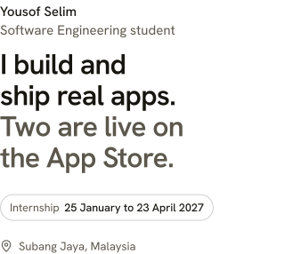</picture><picture><source media="(max-width: 591px), (min-width: 768px) and (max-width: 879px), (min-width: 1154px)" srcset="assets/blank.svg"><source media="(prefers-color-scheme: dark)" srcset="assets/hero-dark-mid.svg">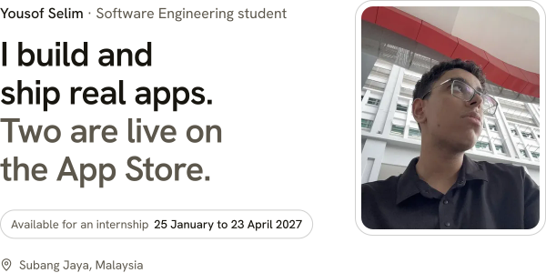</picture><picture><source media="(max-width: 1153px)" srcset="assets/blank.svg"><source media="(prefers-color-scheme: dark)" srcset="assets/hero-dark-wide.svg">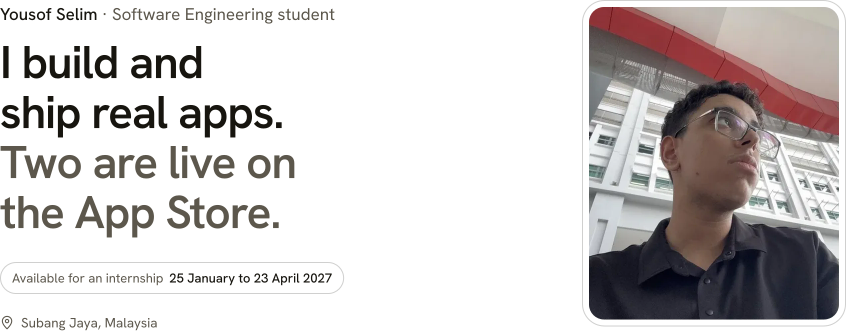</picture></a>

<a href="https://yousofselim.com/Yousof-Selim-Resume.pdf"><picture><source media="(prefers-color-scheme: dark)" srcset="assets/btn-resume-dark.svg">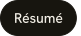</picture></a>
<a href="https://yousofselim.com/simple/"><picture><source media="(prefers-color-scheme: dark)" srcset="assets/btn-recruiters-dark.svg"></picture></a>
<a href="https://yousofselim.com/"><picture><source media="(prefers-color-scheme: dark)" srcset="assets/btn-portfolio-dark.svg"></picture></a>

<a href="https://yousofselim.com/#work" aria-label="Selected work. Five products, one developer on each: me."><picture><source media="(min-width: 592px) and (max-width: 767px), (min-width: 880px)" srcset="assets/blank.svg"><source media="(prefers-color-scheme: dark)" srcset="assets/head-work-dark-phone.svg">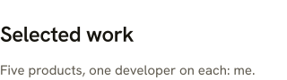</picture><picture><source media="(max-width: 591px), (min-width: 768px) and (max-width: 879px), (min-width: 1154px)" srcset="assets/blank.svg"><source media="(prefers-color-scheme: dark)" srcset="assets/head-work-dark-mid.svg"></picture><picture><source media="(max-width: 1153px)" srcset="assets/blank.svg"><source media="(prefers-color-scheme: dark)" srcset="assets/head-work-dark-wide.svg"></picture></a>

<a href="https://yousofselim.com/work/bupples/" aria-label="Bupples. Live on the App Store and Google Play. Split the bill, skip the awkward follow-up. Scan a receipt, tap who had what, and Bupples works out who owes whom. Built with Flutter, Firebase and Vertex AI. The screenshot shows the profile, accent editor and settings screens."><picture><source media="(min-width: 592px) and (max-width: 767px), (min-width: 880px)" srcset="assets/blank.svg"><source media="(prefers-color-scheme: dark)" srcset="assets/work-bupples-dark-phone.svg">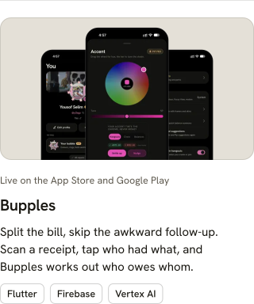</picture><picture><source media="(max-width: 591px), (min-width: 768px) and (max-width: 879px), (min-width: 1154px)" srcset="assets/blank.svg"><source media="(prefers-color-scheme: dark)" srcset="assets/work-bupples-dark-mid.svg">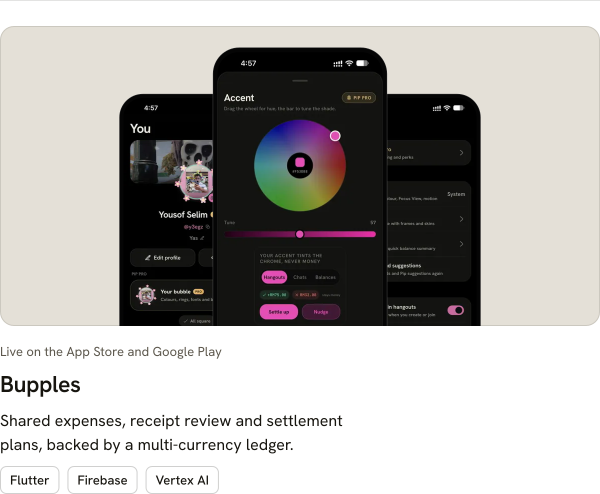</picture><picture><source media="(max-width: 1153px)" srcset="assets/blank.svg"><source media="(prefers-color-scheme: dark)" srcset="assets/work-bupples-dark-wide.svg">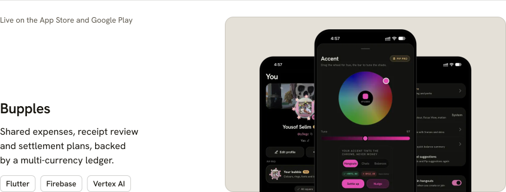</picture></a>

<a href="https://yousofselim.com/work/bupples/"><picture><source media="(prefers-color-scheme: dark)" srcset="assets/go-case-study-dark.svg"></picture></a>
<a href="https://apps.apple.com/my/app/bupples/id6777620291"><picture><source media="(prefers-color-scheme: dark)" srcset="assets/go-app-store-dark.svg">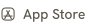</picture></a>
<a href="https://play.google.com/store/apps/details?id=com.bupples.bupples"><picture><source media="(prefers-color-scheme: dark)" srcset="assets/go-google-play-dark.svg"></picture></a>
<a href="https://github.com/yeegz/Bupples-showcase"><picture><source media="(prefers-color-scheme: dark)" srcset="assets/go-showcase-dark.svg"></picture></a>

<a href="https://yousofselim.com/work/adelante/" aria-label="Adelante. Live on the App Store. A daily quote on your Home Screen, Lock Screen and Apple Watch, for the days you don’t feel like opening an app. Built with Flutter, Swift/SwiftUI and Kotlin. The screenshot shows the widget gallery, Today and Discover screens."><picture><source media="(min-width: 592px) and (max-width: 767px), (min-width: 880px)" srcset="assets/blank.svg"><source media="(prefers-color-scheme: dark)" srcset="assets/work-adelante-dark-phone.svg">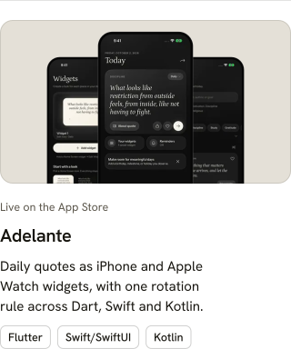</picture><picture><source media="(max-width: 591px), (min-width: 768px) and (max-width: 879px), (min-width: 1154px)" srcset="assets/blank.svg"><source media="(prefers-color-scheme: dark)" srcset="assets/work-adelante-dark-mid.svg">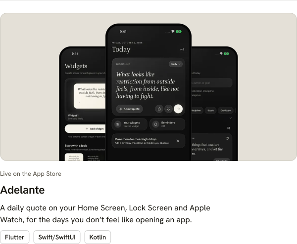</picture><picture><source media="(max-width: 1153px)" srcset="assets/blank.svg"><source media="(prefers-color-scheme: dark)" srcset="assets/work-adelante-dark-wide.svg">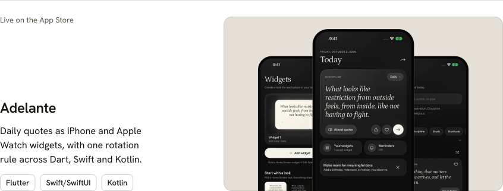</picture></a>

<a href="https://yousofselim.com/work/adelante/"><picture><source media="(prefers-color-scheme: dark)" srcset="assets/go-case-study-dark.svg"></picture></a>
<a href="https://apps.apple.com/us/app/adelante-daily-quotes/id6816598027"><picture><source media="(prefers-color-scheme: dark)" srcset="assets/go-app-store-dark.svg"></picture></a>
<a href="https://github.com/yeegz/adelante-showcase"><picture><source media="(prefers-color-scheme: dark)" srcset="assets/go-showcase-dark.svg"></picture></a>

<a href="https://yousofselim.com/work/wayclub/" aria-label="WayClub. Guided demo with sample data. Student clubs plan events, get them approved and run sign-ups in one place, not across group chats, forms and spreadsheets. Built with Next.js, NestJS and PostgreSQL. The screenshot shows a club workspace with events, proposals and committee members, using fictional data."><picture><source media="(min-width: 592px) and (max-width: 767px), (min-width: 880px)" srcset="assets/blank.svg"><source media="(prefers-color-scheme: dark)" srcset="assets/work-wayclub-dark-phone.svg">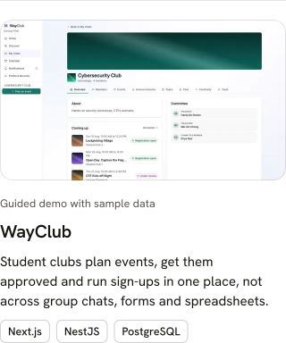</picture><picture><source media="(max-width: 591px), (min-width: 768px) and (max-width: 879px), (min-width: 1154px)" srcset="assets/blank.svg"><source media="(prefers-color-scheme: dark)" srcset="assets/work-wayclub-dark-mid.svg">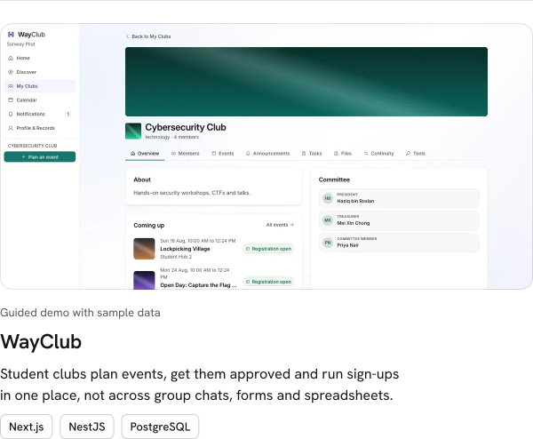</picture><picture><source media="(max-width: 1153px)" srcset="assets/blank.svg"><source media="(prefers-color-scheme: dark)" srcset="assets/work-wayclub-dark-wide.svg">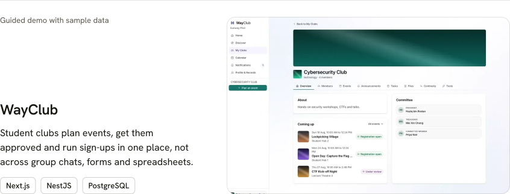</picture></a>

<a href="https://yousofselim.com/work/wayclub/"><picture><source media="(prefers-color-scheme: dark)" srcset="assets/go-case-study-dark.svg"></picture></a>
<a href="https://wayclub-live-demo.web.app/home?tour=1"><picture><source media="(prefers-color-scheme: dark)" srcset="assets/go-demo-dark.svg"></picture></a>
<a href="https://github.com/yeegz/WayClub-showcase"><picture><source media="(prefers-color-scheme: dark)" srcset="assets/go-showcase-dark.svg"></picture></a>

<a href="https://yousofselim.com/work/photoshoot/" aria-label="Photoshoot. Live in your browser · Windows 1.0.1. Strike a pose, pick from 17 live effects, keep the strip. Nothing from your camera ever leaves your device. Built with TypeScript, Electron and MediaPipe. The screenshot shows the red photobooth landing page."><picture><source media="(min-width: 592px) and (max-width: 767px), (min-width: 880px)" srcset="assets/blank.svg"><source media="(prefers-color-scheme: dark)" srcset="assets/work-photoshoot-dark-phone.svg">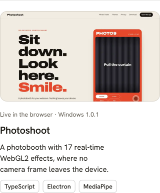</picture><picture><source media="(max-width: 591px), (min-width: 768px) and (max-width: 879px), (min-width: 1154px)" srcset="assets/blank.svg"><source media="(prefers-color-scheme: dark)" srcset="assets/work-photoshoot-dark-mid.svg">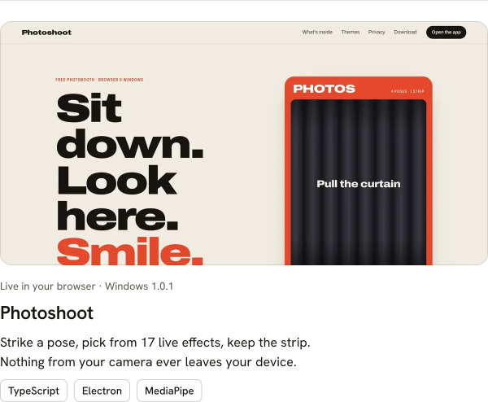</picture><picture><source media="(max-width: 1153px)" srcset="assets/blank.svg"><source media="(prefers-color-scheme: dark)" srcset="assets/work-photoshoot-dark-wide.svg">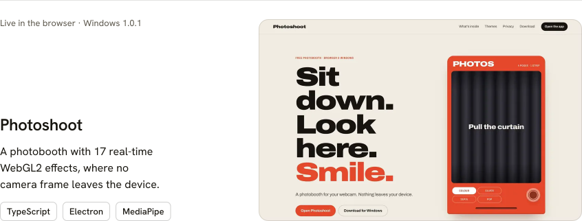</picture></a>

<a href="https://yousofselim.com/work/photoshoot/"><picture><source media="(prefers-color-scheme: dark)" srcset="assets/go-case-study-dark.svg"></picture></a>
<a href="https://photoshoot-yeegz.web.app/app/"><picture><source media="(prefers-color-scheme: dark)" srcset="assets/go-open-app-dark.svg"></picture></a>
<a href="https://github.com/yeegz/photoshoot/releases/tag/v1.0.1"><picture><source media="(prefers-color-scheme: dark)" srcset="assets/go-windows-dark.svg"></picture></a>
<a href="https://github.com/yeegz/photoshoot"><picture><source media="(prefers-color-scheme: dark)" srcset="assets/go-source-dark.svg"></picture></a>

<a href="https://yousofselim.com/work/codeatlas/" aria-label="CodeAtlas. Runs locally · source on GitHub. Green tests don’t always mean nothing broke. CodeAtlas finds the tests a change really reaches, runs the code before and after, and signs what it saw. Built with TypeScript, Node.js and Vitest. The screenshot shows the evidence workspace on a fixture repository."><picture><source media="(min-width: 592px) and (max-width: 767px), (min-width: 880px)" srcset="assets/blank.svg"><source media="(prefers-color-scheme: dark)" srcset="assets/work-codeatlas-dark-phone.svg">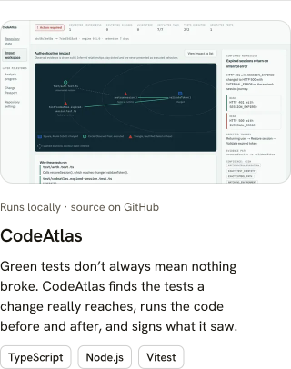</picture><picture><source media="(max-width: 591px), (min-width: 768px) and (max-width: 879px), (min-width: 1154px)" srcset="assets/blank.svg"><source media="(prefers-color-scheme: dark)" srcset="assets/work-codeatlas-dark-mid.svg">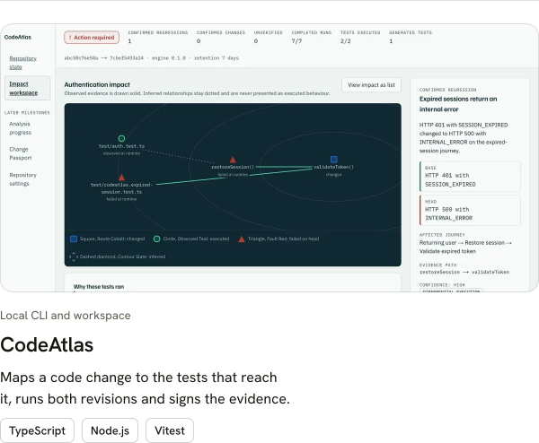</picture><picture><source media="(max-width: 1153px)" srcset="assets/blank.svg"><source media="(prefers-color-scheme: dark)" srcset="assets/work-codeatlas-dark-wide.svg">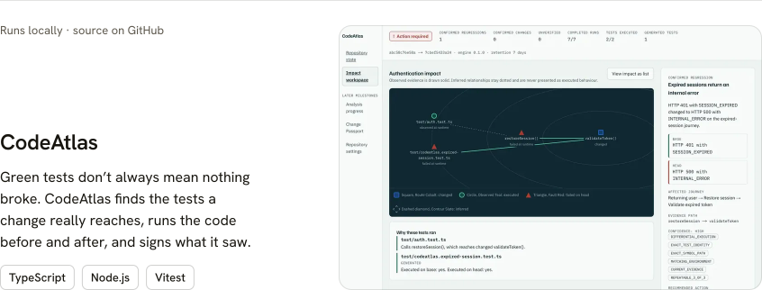</picture></a>

<a href="https://yousofselim.com/work/codeatlas/"><picture><source media="(prefers-color-scheme: dark)" srcset="assets/go-case-study-dark.svg"></picture></a>
<a href="https://github.com/yeegz/CodeAtlas"><picture><source media="(prefers-color-scheme: dark)" srcset="assets/go-source-dark.svg"></picture></a>

<a href="https://yousofselim.com/#skills" aria-label="Skills. Mostly Flutter and Firebase for the apps, and TypeScript for the web and the servers. Mobile: Flutter, Dart, Riverpod, Swift/SwiftUI, Kotlin. Backend and data: TypeScript, NestJS, PostgreSQL, Firebase, REST APIs. Web: React, Next.js, JavaScript, HTML/CSS, WebGL2, Electron. Testing and delivery: Flutter tests, Vitest, Playwright, Firebase Emulator Suite, GitHub Actions, App Store and Google Play releases. Also: Python, Java (working knowledge), Vertex AI and Gemini, MediaPipe, Git."><picture><source media="(min-width: 592px) and (max-width: 767px), (min-width: 880px)" srcset="assets/blank.svg"><source media="(prefers-color-scheme: dark)" srcset="assets/skills-dark-phone.svg">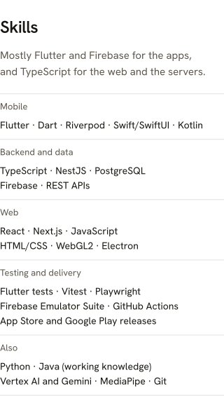</picture><picture><source media="(max-width: 591px), (min-width: 768px) and (max-width: 879px), (min-width: 1154px)" srcset="assets/blank.svg"><source media="(prefers-color-scheme: dark)" srcset="assets/skills-dark-mid.svg">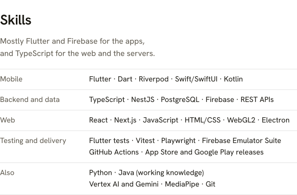</picture><picture><source media="(max-width: 1153px)" srcset="assets/blank.svg"><source media="(prefers-color-scheme: dark)" srcset="assets/skills-dark-wide.svg">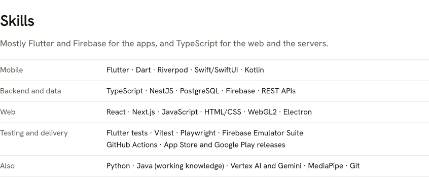</picture></a>

<b>Under the hood</b> · four problems and how I cracked them

#### Bupples: the payment that went nowhere

A owes B, and B owes C. The simplified plan says A should just pay C, which is neat until A actually pays and the app looks for a direct A → C debt to reduce. There isn’t one, so the payment reduced nothing. I changed settlement to pay down the original debts along the chain, so everyone’s balance still adds up. Money is kept in whole minor units, so nothing drifts by a cent. [The ledger decision](https://yousofselim.com/work/bupples/#challenges)

#### Adelante: widgets that agree without talking

The Flutter app, the iOS widgets and the Android widgets run in separate processes and can’t talk to each other. So they don’t need to: they all follow the same clock-based rotation rule and land on the same quote, offline, without waiting for the app to open. iOS also gets a precomputed timeline that fits WidgetKit’s refresh budget. [The widget architecture](https://yousofselim.com/work/adelante/#architecture)

#### WayClub: one database, no peeking

Every club shares one database, so the bug that matters is one club seeing another’s data. Instead of trusting every query to filter correctly, each request runs in a transaction that carries the caller’s verified claims, and PostgreSQL row-level security decides what they can see, under a role that can’t bypass it. Forget a filter and you still only see your own club. [The isolation decision](https://yousofselim.com/work/wayclub/)

#### CodeAtlas: the 500 hiding behind a green suite

A test suite can pass while a changed branch goes untested. On its authentication fixture, CodeAtlas spots an uncovered expired-session path, generates a test for it, and catches the response quietly changing from HTTP 401 to HTTP 500. [What works today](https://github.com/yeegz/CodeAtlas#current-implementation-status)

Bupples, Adelante and WayClub are closed source, but each has a public showcase repo.

Got a minute? Take a detour

My portfolio has [a working terminal](https://yousofselim.com/terminal/). Type `help` and see where it takes you.

Or play [Fallen Asteri](https://yeegz.itch.io/fallenasteri), a Godot platformer our team of three built. I set up our branch-and-pull-request workflow and worked on levels, animation, the HUD and combat tuning. [Source](https://github.com/yeegz/Fallen-Asteri)

<a href="https://yousofselim.com/#contact" aria-label="Hiring interns for January 2027? I’d love to hear what your team is building. Remote or on site both work for me."><picture><source media="(min-width: 592px) and (max-width: 767px), (min-width: 880px)" srcset="assets/blank.svg"><source media="(prefers-color-scheme: dark)" srcset="assets/head-contact-dark-phone.svg">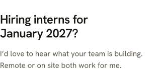</picture><picture><source media="(max-width: 591px), (min-width: 768px) and (max-width: 879px), (min-width: 1154px)" srcset="assets/blank.svg"><source media="(prefers-color-scheme: dark)" srcset="assets/head-contact-dark-mid.svg"></picture><picture><source media="(max-width: 1153px)" srcset="assets/blank.svg"><source media="(prefers-color-scheme: dark)" srcset="assets/head-contact-dark-wide.svg"></picture></a>

<a href="mailto:yousofselim2@gmail.com?subject=Software%20Engineering%20internship%2C%20January%202027"><picture><source media="(prefers-color-scheme: dark)" srcset="assets/btn-email-dark.svg"></picture></a>
<a href="https://www.linkedin.com/in/ysf-slm/"><picture><source media="(prefers-color-scheme: dark)" srcset="assets/btn-linkedin-dark.svg"></picture></a>

Bachelor of Software Engineering (Hons), Sunway University × Lancaster University. Graduating August 2027.
