

<a href="https://yousofselim.com/" aria-label="Yousof Selim, Software Engineering student. I build and ship real apps. Three are live on the App Store. Available for an internship, 25 January to 23 April 2027. Subang Jaya, Malaysia."><picture><source media="(min-width: 592px) and (max-width: 767px), (min-width: 880px)" srcset="assets/blank.svg"><source media="(prefers-color-scheme: dark)" srcset="assets/hero-dark-phone.svg">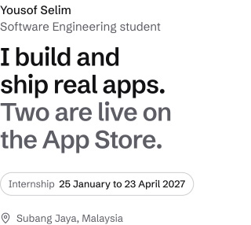</picture><picture><source media="(max-width: 591px), (min-width: 768px) and (max-width: 879px), (min-width: 1154px)" srcset="assets/blank.svg"><source media="(prefers-color-scheme: dark)" srcset="assets/hero-dark-mid.svg">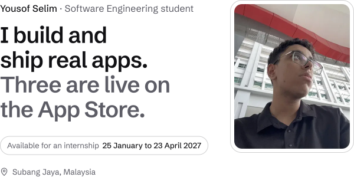</picture><picture><source media="(max-width: 1153px)" srcset="assets/blank.svg"><source media="(prefers-color-scheme: dark)" srcset="assets/hero-dark-wide.svg">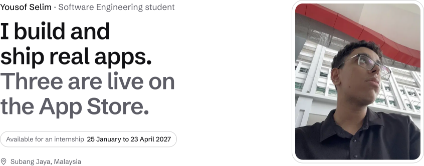</picture></a>

<a href="https://yousofselim.com/Yousof-Selim-Resume.pdf"><picture><source media="(prefers-color-scheme: dark)" srcset="assets/btn-resume-dark.svg"></picture></a>
<a href="https://yousofselim.com/simple/"><picture><source media="(prefers-color-scheme: dark)" srcset="assets/btn-recruiters-dark.svg"></picture></a>
<a href="https://yousofselim.com/"><picture><source media="(prefers-color-scheme: dark)" srcset="assets/btn-portfolio-dark.svg"></picture></a>

<a href="https://yousofselim.com/#work" aria-label="Selected work. Six products in depth. I built each alone, end to end, except Pulse, a team project."><picture><source media="(min-width: 592px) and (max-width: 767px), (min-width: 880px)" srcset="assets/blank.svg"><source media="(prefers-color-scheme: dark)" srcset="assets/head-work-dark-phone.svg"></picture><picture><source media="(max-width: 591px), (min-width: 768px) and (max-width: 879px), (min-width: 1154px)" srcset="assets/blank.svg"><source media="(prefers-color-scheme: dark)" srcset="assets/head-work-dark-mid.svg"></picture><picture><source media="(max-width: 1153px)" srcset="assets/blank.svg"><source media="(prefers-color-scheme: dark)" srcset="assets/head-work-dark-wide.svg"></picture></a>

<a href="https://yousofselim.com/work/bupples/" aria-label="Bupples. App Store and Google Play · 1.5.0. Split the bill, skip the awkward follow-up. Scan a receipt, tap who had what, and Bupples works out who owes whom, to the cent. Built with Flutter, Firebase and Vertex AI. The screenshot shows the receipt claim, Home and hangout balance screens."><picture><source media="(min-width: 592px) and (max-width: 767px), (min-width: 880px)" srcset="assets/blank.svg"><source media="(prefers-color-scheme: dark)" srcset="assets/work-bupples-dark-phone.svg">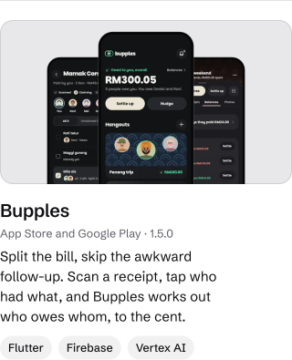</picture><picture><source media="(max-width: 591px), (min-width: 768px) and (max-width: 879px), (min-width: 1154px)" srcset="assets/blank.svg"><source media="(prefers-color-scheme: dark)" srcset="assets/work-bupples-dark-mid.svg">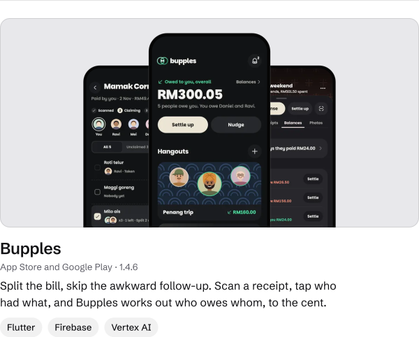</picture><picture><source media="(max-width: 1153px)" srcset="assets/blank.svg"><source media="(prefers-color-scheme: dark)" srcset="assets/work-bupples-dark-wide.svg">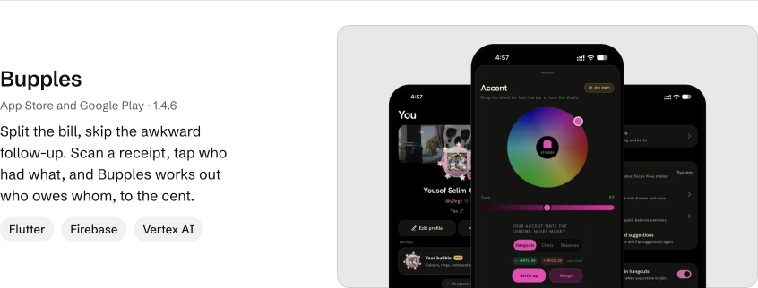</picture></a>

<a href="https://yousofselim.com/work/bupples/"><picture><source media="(prefers-color-scheme: dark)" srcset="assets/go-case-study-dark.svg"></picture></a>
<a href="https://apps.apple.com/my/app/bupples/id6777620291"><picture><source media="(prefers-color-scheme: dark)" srcset="assets/go-app-store-dark.svg"></picture></a>
<a href="https://play.google.com/store/apps/details?id=com.bupples.bupples"><picture><source media="(prefers-color-scheme: dark)" srcset="assets/go-google-play-dark.svg"></picture></a>
<a href="https://github.com/yeegz/Bupples-showcase"><picture><source media="(prefers-color-scheme: dark)" srcset="assets/go-showcase-dark.svg"></picture></a>

<a href="https://yousofselim.com/work/pulse/" aria-label="Pulse. In development · team project. A city of about 150 residents that lives on its own. Ask anyone why they did something, change the city in plain English, and replay the day. Built with TypeScript, three.js and Fastify. The screenshot shows the simulated city from above, with its districts and streets."><picture><source media="(min-width: 592px) and (max-width: 767px), (min-width: 880px)" srcset="assets/blank.svg"><source media="(prefers-color-scheme: dark)" srcset="assets/work-pulse-dark-phone.svg">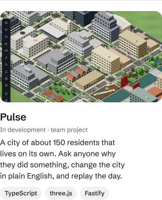</picture><picture><source media="(max-width: 591px), (min-width: 768px) and (max-width: 879px), (min-width: 1154px)" srcset="assets/blank.svg"><source media="(prefers-color-scheme: dark)" srcset="assets/work-pulse-dark-mid.svg">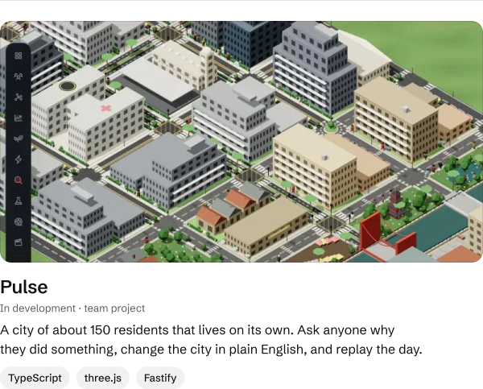</picture><picture><source media="(max-width: 1153px)" srcset="assets/blank.svg"><source media="(prefers-color-scheme: dark)" srcset="assets/work-pulse-dark-wide.svg">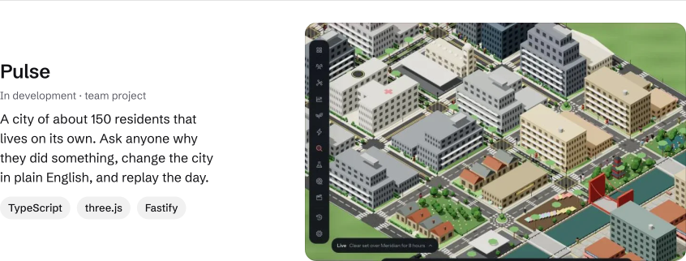</picture></a>

<a href="https://yousofselim.com/work/pulse/"><picture><source media="(prefers-color-scheme: dark)" srcset="assets/go-case-study-dark.svg"></picture></a>
<a href="https://pulse-ihzwsnnyfa-as.a.run.app"><picture><source media="(prefers-color-scheme: dark)" srcset="assets/go-demo-dark.svg"></picture></a>

<a href="https://yousofselim.com/work/keepwell/" aria-label="Keepwell. Live demo · pre-pilot. Maintenance for estates, factories, campuses and hotels. The technician’s app keeps working in a plant room with no signal, and two people can never be promised the same spare part. Built with Java, Spring Boot, PostgreSQL and Angular. The screenshot shows the manager’s overview with the jobs that need a decision, on sample data."><picture><source media="(min-width: 592px) and (max-width: 767px), (min-width: 880px)" srcset="assets/blank.svg"><source media="(prefers-color-scheme: dark)" srcset="assets/work-keepwell-dark-phone.svg">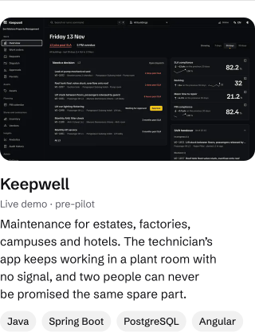</picture><picture><source media="(max-width: 591px), (min-width: 768px) and (max-width: 879px), (min-width: 1154px)" srcset="assets/blank.svg"><source media="(prefers-color-scheme: dark)" srcset="assets/work-keepwell-dark-mid.svg">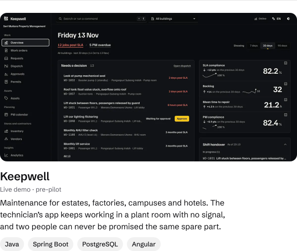</picture><picture><source media="(max-width: 1153px)" srcset="assets/blank.svg"><source media="(prefers-color-scheme: dark)" srcset="assets/work-keepwell-dark-wide.svg">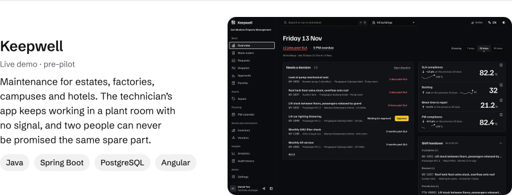</picture></a>

<a href="https://yousofselim.com/work/keepwell/"><picture><source media="(prefers-color-scheme: dark)" srcset="assets/go-case-study-dark.svg"></picture></a>
<a href="https://keepwell-951434273932.asia-southeast1.run.app"><picture><source media="(prefers-color-scheme: dark)" srcset="assets/go-demo-dark.svg"></picture></a>
<a href="https://github.com/yeegz/keepwell-showcase"><picture><source media="(prefers-color-scheme: dark)" srcset="assets/go-showcase-dark.svg"></picture></a>

<a href="https://yousofselim.com/work/hostmortem/" aria-label="Hostmortem. Open source · v0.1.0. It was fine, then it wasn’t, then someone rebooted it. Hostmortem keeps the minutes before on a Linux box and says what it knows, suspects and could not see. Built with C++20, Linux and SQLite. The screenshot shows the replay of a real upstream DNS outage on a five-lane tape, with the verdict underneath."><picture><source media="(min-width: 592px) and (max-width: 767px), (min-width: 880px)" srcset="assets/blank.svg"><source media="(prefers-color-scheme: dark)" srcset="assets/work-hostmortem-dark-phone.svg">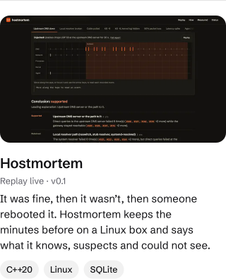</picture><picture><source media="(max-width: 591px), (min-width: 768px) and (max-width: 879px), (min-width: 1154px)" srcset="assets/blank.svg"><source media="(prefers-color-scheme: dark)" srcset="assets/work-hostmortem-dark-mid.svg">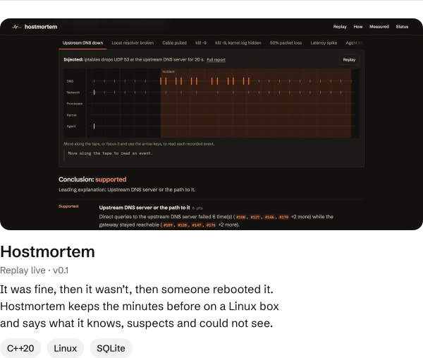</picture><picture><source media="(max-width: 1153px)" srcset="assets/blank.svg"><source media="(prefers-color-scheme: dark)" srcset="assets/work-hostmortem-dark-wide.svg">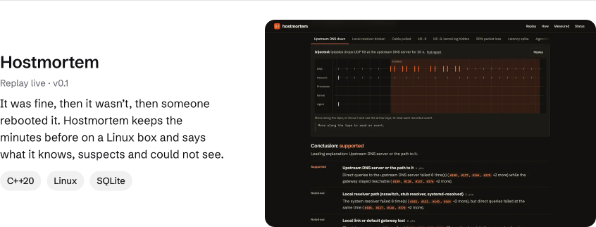</picture></a>

<a href="https://yousofselim.com/work/hostmortem/"><picture><source media="(prefers-color-scheme: dark)" srcset="assets/go-case-study-dark.svg"></picture></a>
<a href="https://yousofselim.com/hostmortem-showcase/"><picture><source media="(prefers-color-scheme: dark)" srcset="assets/go-demo-dark.svg"></picture></a>
<a href="https://github.com/yeegz/hostmortem"><picture><source media="(prefers-color-scheme: dark)" srcset="assets/go-source-dark.svg"></picture></a>

<a href="https://yousofselim.com/work/planket/" aria-label="Planket. App Store · web app live. See when your friends are free and send a plan in three taps. Your calendar stays private: friends see busy time, never what you are doing. Built with Next.js, Capacitor and Supabase. The screenshot shows the plan, shared calendar and friends screens."><picture><source media="(min-width: 592px) and (max-width: 767px), (min-width: 880px)" srcset="assets/blank.svg"><source media="(prefers-color-scheme: dark)" srcset="assets/work-planket-dark-phone.svg">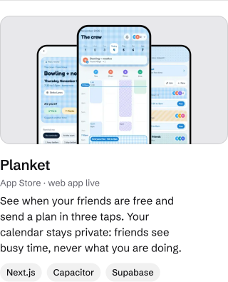</picture><picture><source media="(max-width: 591px), (min-width: 768px) and (max-width: 879px), (min-width: 1154px)" srcset="assets/blank.svg"><source media="(prefers-color-scheme: dark)" srcset="assets/work-planket-dark-mid.svg">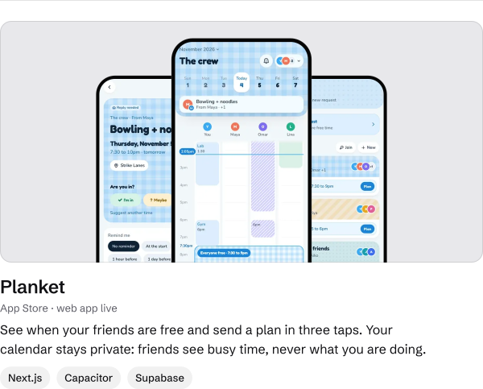</picture><picture><source media="(max-width: 1153px)" srcset="assets/blank.svg"><source media="(prefers-color-scheme: dark)" srcset="assets/work-planket-dark-wide.svg">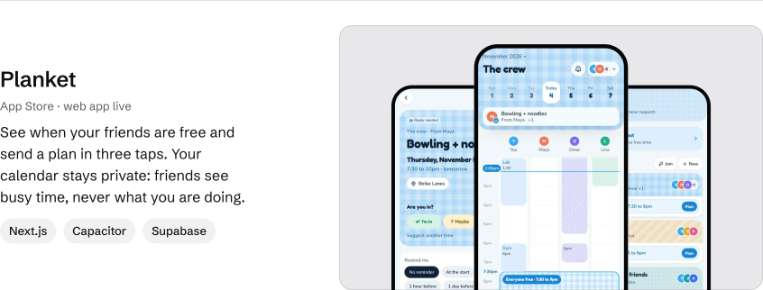</picture></a>

<a href="https://yousofselim.com/work/planket/"><picture><source media="(prefers-color-scheme: dark)" srcset="assets/go-case-study-dark.svg"></picture></a>
<a href="https://apps.apple.com/my/app/planket/id6825034126"><picture><source media="(prefers-color-scheme: dark)" srcset="assets/go-app-store-dark.svg"></picture></a>
<a href="https://planket-yeegz.web.app"><picture><source media="(prefers-color-scheme: dark)" srcset="assets/go-open-app-dark.svg"></picture></a>
<a href="https://github.com/yeegz/planket-showcase"><picture><source media="(prefers-color-scheme: dark)" srcset="assets/go-showcase-dark.svg"></picture></a>

<a href="https://yousofselim.com/work/photoshoot/" aria-label="Photoshoot. Web app and Windows 1.5.1. Strike a pose, pick from 52 live effects and reactive face masks, keep the strip. Nothing from your camera leaves your device. Built with TypeScript, Electron, WebGL2 and MediaPipe. The screenshot shows the Photoshoot product site for version 1.5.1."><picture><source media="(min-width: 592px) and (max-width: 767px), (min-width: 880px)" srcset="assets/blank.svg"><source media="(prefers-color-scheme: dark)" srcset="assets/work-photoshoot-dark-phone.svg">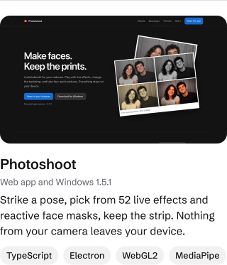</picture><picture><source media="(max-width: 591px), (min-width: 768px) and (max-width: 879px), (min-width: 1154px)" srcset="assets/blank.svg"><source media="(prefers-color-scheme: dark)" srcset="assets/work-photoshoot-dark-mid.svg">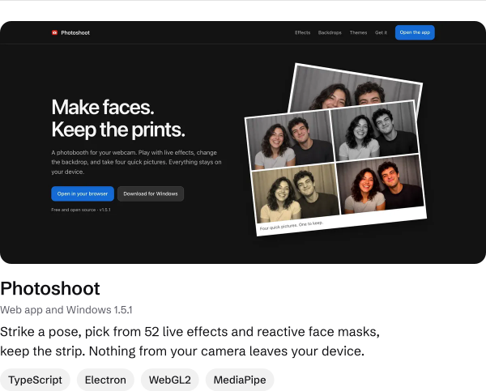</picture><picture><source media="(max-width: 1153px)" srcset="assets/blank.svg"><source media="(prefers-color-scheme: dark)" srcset="assets/work-photoshoot-dark-wide.svg">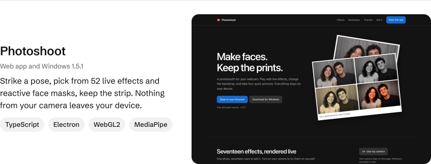</picture></a>

<a href="https://yousofselim.com/work/photoshoot/"><picture><source media="(prefers-color-scheme: dark)" srcset="assets/go-case-study-dark.svg"></picture></a>
<a href="https://photoshoot-yeegz.web.app/app/"><picture><source media="(prefers-color-scheme: dark)" srcset="assets/go-open-app-dark.svg"></picture></a>
<a href="https://github.com/yeegz/photoshoot/releases/tag/v1.5.1"><picture><source media="(prefers-color-scheme: dark)" srcset="assets/go-windows-dark.svg"></picture></a>
<a href="https://github.com/yeegz/photoshoot"><picture><source media="(prefers-color-scheme: dark)" srcset="assets/go-source-dark.svg"></picture></a>

<a href="https://yousofselim.com/#work" aria-label="More work. Four more. Each status says exactly how far along it is. Adelante: App Store · 1.1.0. A daily quote on your Home Screen, Lock Screen and Apple Watch, with one rotation rule in Dart, Swift and Kotlin. TrustTrail: Web app live · beta. Lays out a secondhand deal’s evidence and shows the exact words behind each warning sign, privately in your browser. LetMeKnow: Web app live. Turns messages, bills and promises into open loops, with a plan to close each one. WayClub: Preview live · paused. Events, tickets and committee work for teams, clubs and communities, isolated per group in the database."><picture><source media="(min-width: 592px) and (max-width: 767px), (min-width: 880px)" srcset="assets/blank.svg"><source media="(prefers-color-scheme: dark)" srcset="assets/building-dark-phone.svg">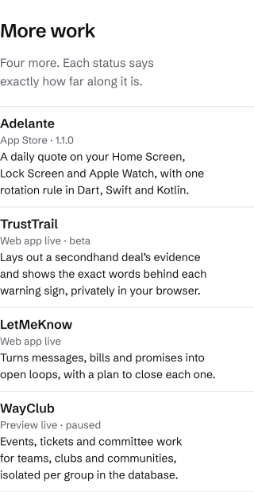</picture><picture><source media="(max-width: 591px), (min-width: 768px) and (max-width: 879px), (min-width: 1154px)" srcset="assets/blank.svg"><source media="(prefers-color-scheme: dark)" srcset="assets/building-dark-mid.svg">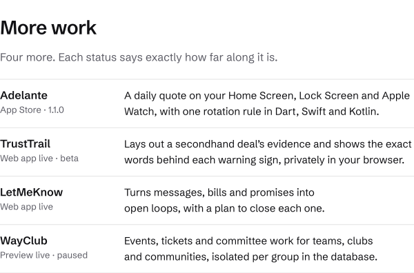</picture><picture><source media="(max-width: 1153px)" srcset="assets/blank.svg"><source media="(prefers-color-scheme: dark)" srcset="assets/building-dark-wide.svg">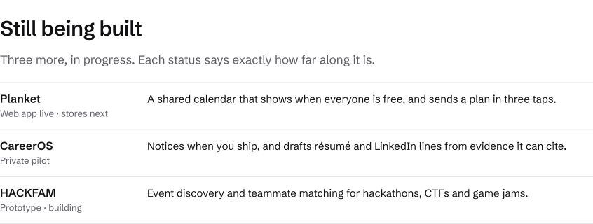</picture></a>

Case studies: [Adelante](https://yousofselim.com/work/adelante/) · [TrustTrail](https://yousofselim.com/work/trusttrail/) · [LetMeKnow](https://yousofselim.com/work/letmeknow/) · [WayClub](https://yousofselim.com/work/wayclub/)

<a href="https://yousofselim.com/research/" aria-label="Engineering reports. Measurements from my own products, each with its data and scripts. 119× shorter waits behind slow requests after one lock fix: Testing PostgreSQL Tenant Isolation (WayClub). 97% of float-based ledgers ended up not adding up: Cent-Exact Ledger (Bupples). 8 bugs around clock changes that the existing tests missed: One Rule, Three Runtimes (Adelante). 4× lower frame rate once face tracking switches on: Sixteen Milliseconds (Photoshoot)."><picture><source media="(min-width: 592px) and (max-width: 767px), (min-width: 880px)" srcset="assets/blank.svg"><source media="(prefers-color-scheme: dark)" srcset="assets/reports-dark-phone.svg">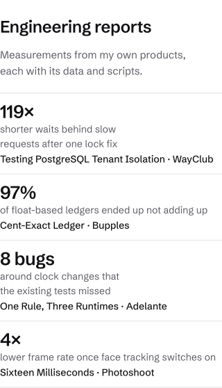</picture><picture><source media="(max-width: 591px), (min-width: 768px) and (max-width: 879px), (min-width: 1154px)" srcset="assets/blank.svg"><source media="(prefers-color-scheme: dark)" srcset="assets/reports-dark-mid.svg">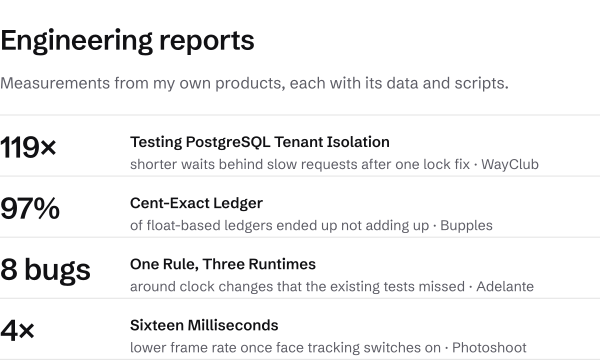</picture><picture><source media="(max-width: 1153px)" srcset="assets/blank.svg"><source media="(prefers-color-scheme: dark)" srcset="assets/reports-dark-wide.svg">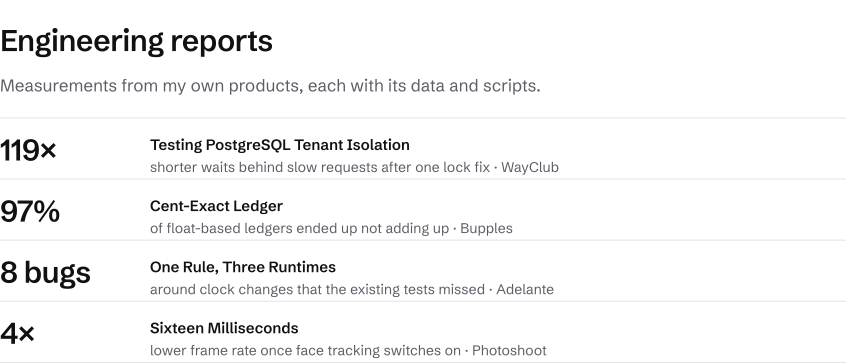</picture></a>

Read: [Testing PostgreSQL Tenant Isolation](https://yousofselim.com/research/catalogue-driven-rls/) · [Cent-Exact Ledger](https://yousofselim.com/research/cent-exact-ledger/) · [One Rule, Three Runtimes](https://yousofselim.com/research/one-rule-three-runtimes/) · [Sixteen Milliseconds](https://yousofselim.com/research/frame-budget/) · [all eight reports](https://yousofselim.com/research/)

<a href="https://yousofselim.com/#skills" aria-label="Skills. Flutter for the apps, TypeScript and Java for the servers, and C++ close to the system. Mobile: Flutter, Dart, Riverpod, Swift/SwiftUI, Kotlin, Capacitor. Backend and data: TypeScript, Java, Spring Boot, NestJS, PostgreSQL, Supabase, Firebase, SQLite. Systems: C++20, Linux, CMake, Docker. Web: React, Next.js, Angular, JavaScript, HTML/CSS, WebGL2, Electron. Testing and delivery: Flutter tests, Vitest, Playwright, JUnit, Fuzzing and sanitizers, GitHub Actions, App Store and Google Play releases. Also: Python, Vertex AI and Gemini, MediaPipe, Git."><picture><source media="(min-width: 592px) and (max-width: 767px), (min-width: 880px)" srcset="assets/blank.svg"><source media="(prefers-color-scheme: dark)" srcset="assets/skills-dark-phone.svg">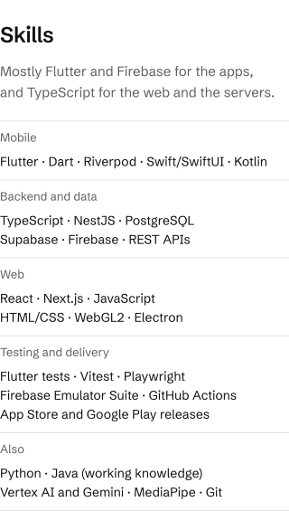</picture><picture><source media="(max-width: 591px), (min-width: 768px) and (max-width: 879px), (min-width: 1154px)" srcset="assets/blank.svg"><source media="(prefers-color-scheme: dark)" srcset="assets/skills-dark-mid.svg">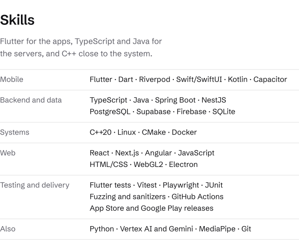</picture><picture><source media="(max-width: 1153px)" srcset="assets/blank.svg"><source media="(prefers-color-scheme: dark)" srcset="assets/skills-dark-wide.svg">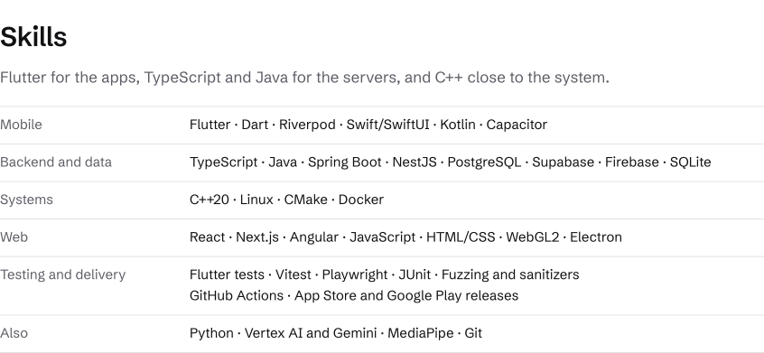</picture></a>

<b>Under the hood</b> · four problems and how I cracked them

#### Bupples: the payment that went nowhere

A owes B, and B owes C. The simplified plan says A should just pay C, which is neat until A actually pays and the app looks for a direct A → C debt to reduce. There isn’t one, so the payment reduced nothing. I changed settlement to pay down the original debts along the chain. Money is kept in whole minor units, so nothing drifts by a cent; [the ledger report](https://yousofselim.com/research/cent-exact-ledger/) measures it over four million simulated bills.

#### Adelante: widgets that agree without talking

The Flutter app, the iOS widgets and the Android widgets run in separate processes and can’t talk to each other. So they don’t need to: they all follow the same clock-based rotation rule and land on the same quote, offline. Running the three versions side by side then found eight clock-change cases where they disagree; [the report](https://yousofselim.com/research/one-rule-three-runtimes/) has the details.

#### WayClub: one database, no peeking

Every club shares one database, so the bug that matters is one club seeing another’s data. Each request runs in a transaction that carries the caller’s verified claims, and PostgreSQL row-level security decides what they can see, under a role that can’t bypass it. Forget a filter and you still only see your own club. [The isolation report](https://yousofselim.com/research/catalogue-driven-rls/)

#### CodeAtlas: the 500 hiding behind a green suite

A test suite can pass while a changed branch goes untested. On its authentication fixture, CodeAtlas spots an uncovered expired-session path, generates a test for it, and catches the response quietly changing from HTTP 401 to HTTP 500. [What works today](https://github.com/yeegz/CodeAtlas#current-implementation-status)

Bupples, Adelante, WayClub and Keepwell are closed source, but each has a public showcase repo. Hostmortem is open source.

Got a minute? Take a detour

My portfolio has [a working terminal](https://yousofselim.com/terminal/). Type `help` and see where it takes you.

Or play [Fallen Asteri](https://yeegz.itch.io/fallenasteri), a Godot platformer our team of three built. I set up our branch-and-pull-request workflow and worked on levels, animation, the HUD and combat tuning. [Source](https://github.com/yeegz/Fallen-Asteri)

<a href="https://yousofselim.com/#contact" aria-label="Hiring interns for January 2027? I’m available full-time from 25 January to 23 April 2027. Email is the quickest way to reach me."><picture><source media="(min-width: 592px) and (max-width: 767px), (min-width: 880px)" srcset="assets/blank.svg"><source media="(prefers-color-scheme: dark)" srcset="assets/head-contact-dark-phone.svg">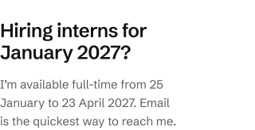</picture><picture><source media="(max-width: 591px), (min-width: 768px) and (max-width: 879px), (min-width: 1154px)" srcset="assets/blank.svg"><source media="(prefers-color-scheme: dark)" srcset="assets/head-contact-dark-mid.svg"></picture><picture><source media="(max-width: 1153px)" srcset="assets/blank.svg"><source media="(prefers-color-scheme: dark)" srcset="assets/head-contact-dark-wide.svg"></picture></a>

<a href="mailto:yousofselim2@gmail.com?subject=Software%20Engineering%20internship%2C%20January%202027"><picture><source media="(prefers-color-scheme: dark)" srcset="assets/btn-email-dark.svg"></picture></a>
<a href="https://www.linkedin.com/in/ysf-slm/"><picture><source media="(prefers-color-scheme: dark)" srcset="assets/btn-linkedin-dark.svg"></picture></a>

Bachelor of Software Engineering (Hons), Sunway University × Lancaster University. Graduating August 2027.
